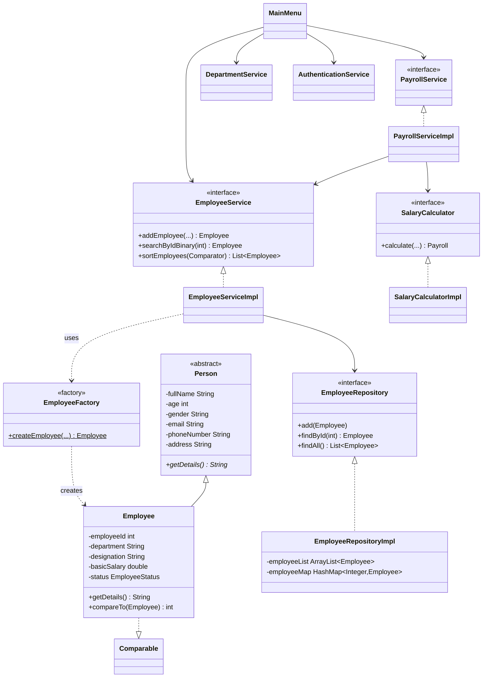

# Employee Management System

A professional, menu-driven **Employee Management System** built entirely in **Core Java** (Java 17+), with no external frameworks and no database — all data is held in Java Collections at runtime and persisted to flat files under `data/`.

---

## Table of Contents

1. [Project Overview](#project-overview)
2. [Features](#features)
3. [Concepts Used](#concepts-used)
4. [Folder Structure](#folder-structure)
5. [Class Diagram](#class-diagram)
6. [Design Patterns Used](#design-patterns-used)
7. [SOLID Principles Used](#solid-principles-used)
8. [Compilation Steps](#compilation-steps)
9. [How to Login](#how-to-login)
10. [Menu Explanation](#menu-explanation)
11. [Salary Calculation Formula](#salary-calculation-formula)
12. [Leave Rules](#leave-rules)
13. [Permission Rules](#permission-rules)
14. [Validation Rules](#validation-rules)
15. [Future Enhancements](#future-enhancements)
16. [Troubleshooting](#troubleshooting)
17. [Author](#author)
18. [License](#license)
19. [Screenshots](#screenshots)

---

## Project Overview

This project is a console-based Employee Management System intended as a portfolio-quality demonstration of Core Java fundamentals: OOP, Collections, exception handling, file I/O, design patterns and SOLID design — all wired together into one coherent, runnable application rather than isolated snippets.

The application boots into a login screen, authenticates against locally-stored (SHA-256 hashed) credentials, and then presents a full menu system covering Employee, Department, Attendance, Leave, and Payroll management, plus search, reporting, account, and system-utility tools.

All data is kept in memory (`ArrayList` / `HashMap`) during a session and mirrored to plain-text files in `data/` after every change, so state survives an application restart.

## Features

- Secure login (max 3 attempts, SHA-256-hashed passwords, password change, login history)
- Full Employee CRUD with 14 tracked fields per employee and rich validation
- Department management with employee assignment and per-department counts
- Attendance tracking (working/present/absent/leave days, permission hours, late entries) with monthly reports
- Leave management (Casual / Medical / Emergency / Loss-of-Pay) with apply / approve / reject / cancel / balance workflow
- Payroll generation with full salary-slip breakdown, salary history, and monthly/yearly payroll views
- Standalone Salary Calculator that reproduces the exact formula and worked example from the specification
- Employee search by ID (binary search), name/department/designation (linear search), and phone/email (map-backed lookup)
- Nine report types (all employees, department-wise, highest/lowest/average salary, attendance, leave, payroll, joined-this-year, inactive, salary statistics)
- Backup / restore / export / reset system utilities
- Every screen is menu-driven with consistent, professional console formatting and graceful handling of invalid input — the application never crashes on bad input

## Concepts Used

| Concept | Where it appears |
|---|---|
| Arrays | `String[]` parsing throughout persistence code (e.g. `EmployeeRepositoryImpl`, `UtilityMenu`) |
| ArrayList | `EmployeeRepositoryImpl`, `AttendanceServiceImpl`, `LeaveServiceImpl`, `PayrollServiceImpl` |
| Strings / regex | `ValidationUtil` (name, email, phone, date patterns) |
| Binary Search | `EmployeeServiceImpl.searchByIdBinary()` — hand-written, on a list sorted via `Comparable` |
| Sorting / `Collections.sort()` | `EmployeeServiceImpl.sortEmployees()`, `EmployeeServiceImpl.searchByIdBinary()` |
| HashMap | `EmployeeRepositoryImpl` (ID → Employee), `DepartmentRepositoryImpl`, `AuthenticationServiceImpl` (username → User) |
| OOP: Encapsulation | Private fields + getters/setters on every model class |
| OOP: Abstraction | `Person` abstract class with an abstract `getDetails()` |
| OOP: Inheritance | `Employee extends Person` |
| OOP: Polymorphism | `Employee` overrides `getDetails()`/`toString()`; every service is programmed to its interface |
| SOLID Principles | See [dedicated section](#solid-principles-used) |
| Factory Design Pattern | `EmployeeFactory` |
| Exception Handling | `try/catch` throughout the UI layer |
| Custom Exceptions | 8 checked exception types (see [Design Patterns](#design-patterns-used) area / `exception` package) |
| Interfaces | Every service and repository is interface-first (`EmployeeService`, `EmployeeRepository`, etc.) |
| File Handling | `FileManager`, auto-creates files/directories if absent |
| Java Collections Framework | `List`, `Map`, `ArrayList`, `HashMap`, `LinkedHashMap`, `TreeMap` |
| Comparable / Comparator | `Employee implements Comparable<Employee>`; `EmployeeComparators` supplies named `Comparator`s |
| Input Validation | `ValidationUtil` + `InputReader`'s loop-until-valid read methods |
| Modular Programming | 8 packages, each with a single responsibility (`model`, `service`, `repository`, `factory`, `util`, `exception`, `ui`, default) |

## Folder Structure

```
EmployeeManagementSystem/
├── src/
│   ├── Main.java                     (entry point, default package)
│   ├── model/                        (Employee, Department, Attendance, LeaveRecord, Payroll, User, enums...)
│   ├── service/                      (interfaces + *Impl business logic)
│   ├── repository/                   (interfaces + *Impl data access - ArrayList/HashMap + file mirror)
│   ├── factory/                      (EmployeeFactory)
│   ├── util/                         (ValidationUtil, InputReader, FileManager, Constants)
│   ├── exception/                    (8 custom checked exceptions)
│   └── ui/                           (LoginUI, MainMenu, and one *Menu per module)
├── data/                             (sample seed data + runtime persistence; auto-created if missing)
│   ├── users.txt
│   ├── employees.txt
│   ├── departments.txt
│   ├── attendance.txt
│   ├── leave.txt
│   └── payroll.txt
├── README.md
└── LICENSE
```

Note on packages: because the project uses real Java packages (matching the folder layout above) rather than one flat `default` package, the exact `javac *.java` / `java Main` two-liner from a typical "no-package" toy project doesn't apply verbatim — see [Compilation Steps](#compilation-steps) for the correct, equivalent commands.

## Class Diagram



*(Departments, Attendance, Leave, and Authentication follow the same interface → `*Impl` → repository/file pattern as Employee, and are omitted above purely for diagram readability.)*

## Design Patterns Used

- **Factory Pattern** — `factory.EmployeeFactory` is the single place `Employee` objects are constructed for the running application (used exclusively by `EmployeeServiceImpl.addEmployee`); it enforces ID/salary invariants at creation time so no caller can bypass them.
- **Repository Pattern** — `EmployeeRepository` / `DepartmentRepository` abstract persistence behind an interface so the service layer never touches file I/O directly.
- **Dependency Injection (constructor-based)** — every service/UI class receives its collaborators through its constructor (wired centrally in `Main.java`), rather than constructing them itself.
- **Strategy-style Comparators** — `EmployeeComparators` supplies interchangeable `Comparator<Employee>` strategies (by ID, name, salary, department, joining date) selected at runtime by the Sort Employees menu.

## SOLID Principles Used

| Principle | How it's applied |
|---|---|
| **S** — Single Responsibility | `SalaryCalculator` only computes a salary breakdown; `ValidationUtil` only validates; `FileManager` only does file I/O; each `*Service` owns exactly one module's business rules. |
| **O** — Open/Closed | New sort orders are added by adding a new `Comparator` constant to `EmployeeComparators`, not by editing `EmployeeServiceImpl`; new employee-creation rules can be added inside `EmployeeFactory` without touching its callers. |
| **L** — Liskov Substitution | Every `*ServiceImpl` / `*RepositoryImpl` can be used anywhere its interface is expected without altering correctness (e.g. `EmployeeRepository repo = new EmployeeRepositoryImpl();`). |
| **I** — Interface Segregation | Interfaces are split per module (`EmployeeService`, `DepartmentService`, `AttendanceService`, ...) instead of one giant "SystemService" — callers depend only on the methods they actually use. |
| **D** — Dependency Inversion | High-level modules (`ui`) depend on abstractions (`EmployeeService`, `PayrollService`, ...), never on `*Impl` classes directly; concrete wiring happens once, in `Main.java`. |

## Compilation Steps

The project uses real Java packages matching the `src/` folder layout, so source files must be compiled together with `-d` to place compiled classes into a package-correct output directory.

### Run using Terminal

**Linux / macOS:**

```bash
cd EmployeeManagementSystem
javac -d bin src/Main.java src/model/*.java src/service/*.java src/repository/*.java src/factory/*.java src/util/*.java src/exception/*.java src/ui/*.java
java -cp bin Main
```

*(Equivalently: `javac -d bin $(find src -name "*.java")`)*

**Windows (Command Prompt / PowerShell):**

```
cd EmployeeManagementSystem
javac -d bin src\Main.java src\model\*.java src\service\*.java src\repository\*.java src\factory\*.java src\util\*.java src\exception\*.java src\ui\*.java
java -cp bin Main
```

Run the `java` command from the `EmployeeManagementSystem` folder (not from inside `bin`) so the relative path `data/` resolves correctly and the app can find/create its data files.

### Run using VS Code

1. Install the **Extension Pack for Java** (Microsoft) in VS Code.
2. Open the `EmployeeManagementSystem` folder (`File → Open Folder…`).
3. VS Code's Java extension auto-detects `src/` as the source root (no `pom.xml`/`build.gradle` needed for this simple layout).
4. Open `src/Main.java` and click the **Run** ▷ button above `main()` (or use *Run → Run Without Debugging*).
5. Use the **Terminal** panel inside VS Code (not the "Debug Console") if you need to type input at the login prompt — some panels don't forward keystrokes to `System.in`.

Requires **JDK 17 or later** on your `PATH` (check with `java -version` / `javac -version`).

## How to Login

```
Default Username: admin
Default Password: admin123
```

The default admin account is created automatically the first time the app runs with no `data/users.txt` present (or an empty one). The project also ships a ready-made `data/users.txt` with this same account pre-hashed (SHA-256), so you can log in immediately without a first-run bootstrap step. You can change the password after logging in via **User Account → Change Password**. Login is limited to **3 attempts**, after which the application terminates.

## Menu Explanation

| # | Menu | What it does |
|---|---|---|
| 1 | Employee Management | Add / view / update / delete / search / sort employees; employee statistics |
| 2 | Department Management | Add / update / delete / view departments; assign employees; per-department counts |
| 3 | Attendance Management | Record/update monthly attendance; view history; generate monthly reports |
| 4 | Leave Management | Apply / approve / reject / cancel leave; view history & balance; LOP calculator |
| 5 | Payroll Management | Generate salary, view slips, salary history, monthly/yearly payroll, export report |
| 6 | Salary Calculator | Standalone full salary breakdown from manually entered components |
| 7 | Search Employee | Search by ID (binary search), name/department/designation (linear), phone/email |
| 8 | Reports | 9 report types across employees, salary, attendance, and status |
| 9 | User Account | Change password, view profile, view login history, logout |
| 10 | System Utilities | Backup / restore data, export employee list, reset system, About, Help |
| 11 | Exit | Confirms, then closes the application |

## Salary Calculation Formula

```
Net Salary = Basic Salary + HRA + DA + Bonus + Allowance
             − Tax − Provident Fund − Leave Deduction − Permission Deduction
```

Where:
```
Leave Deduction      = Leave Days      × ₹500
Permission Deduction = Permission Hrs  × ₹50
```

**Worked example** (matches the Salary Calculator menu exactly):

| Component | Value |
|---|---|
| Basic Salary | ₹40,000 |
| HRA | ₹5,000 |
| DA | ₹3,000 |
| Bonus | ₹2,000 |
| Tax | ₹2,500 |
| Provident Fund | ₹1,800 |
| Leave | 2 days → ₹1,000 deduction |
| Permission | 4 hours → ₹200 deduction |
| **Net Salary** | **₹44,500** |

In the **Payroll Management → Generate Salary** flow (which only asks for Bonus and Allowance, pulling Basic Salary from the employee's record), HRA/DA/Tax/PF are derived automatically using a standard policy of 20% / 10% / 5% / 12% of Basic Salary respectively — the underlying `SalaryCalculator` itself is a pure summation of whatever components it's given, exactly per the formula above.

## Leave Rules

- Leave types: **Casual**, **Medical**, **Emergency**, **Loss of Pay**
- Each employee has a 12-day annual entitlement per leave type (excluding Loss of Pay, which is unlimited but always paid-deducted)
- Leave applications start as `PENDING` and must be `APPROVED` before they count against balance or trigger payroll deduction
- Applying for more days than the remaining balance is rejected with a clear error (except Loss of Pay)

## Permission Rules

- Permission is tracked in fractional hours per month per employee
- Every permission hour taken is deducted at a flat **₹50/hour**, independent of leave-day deductions

## Validation Rules

The application never crashes on bad input — every read loops with a clear, re-promptable error message until valid input is given, or gracefully returns to the menu.

| Field | Rule |
|---|---|
| Age | Numeric, 18–65 |
| Salary / Bonus / Allowance / Tax / PF | Numeric, ≥ 0 |
| Phone / Emergency Contact | Exactly 10 digits |
| Email | Standard `local@domain.tld` pattern |
| Name | Alphabets and spaces only, 2–50 characters |
| Employee ID | Positive integer, must be unique |
| Leave Days / Permission Hours | Numeric, ≥ 0 |
| Date fields | `yyyy-MM-dd` format |
| Menu choice | Numeric; anything else redisplays the current menu with an error, never exits or crashes |

## Future Enhancements

- Swap flat-file persistence for an embedded database (e.g. SQLite via JDBC) behind the existing `Repository` interfaces — no service-layer changes required
- Role-based access control (e.g. read-only "Staff" role vs. full "Admin" role)
- REST API layer on top of the existing service interfaces
- CSV/Excel export for reports (currently plain-text export)
- Automated unit tests (JUnit 5) for the service layer

## Troubleshooting

| Symptom | Likely Cause / Fix |
|---|---|
| `javac: command not found` | JDK isn't installed or isn't on your `PATH`. Install JDK 17+ and re-open your terminal. |
| `Error: Could not find or load main class Main` | You ran `java` from the wrong directory, or forgot `-cp bin`. Run `java -cp bin Main` from the project root. |
| Password typed is visible (not masked) | Some IDE consoles (including VS Code's Debug Console) don't provide a real terminal (`java.io.Console` is `null`), so masking silently falls back to plain input. Run from an actual terminal, or use VS Code's integrated **Terminal**, for masked input. |
| "Invalid Input" loops forever | You're entering a value that doesn't satisfy the field's rule (see [Validation Rules](#validation-rules)) — re-read the printed error message for the exact requirement. |
| Data doesn't persist between runs | Make sure you're launching `java` from the `EmployeeManagementSystem` folder each time, so the relative `data/` path resolves consistently. |
| `data/*.txt` missing on first run | This is expected — `FileManager` auto-creates any missing file/folder the first time it's needed. |

## Author

Employee Management System — Core Java portfolio project.

## License

Released under the MIT License — see [`LICENSE`](./LICENSE).

## Screenshots

*(Add terminal screenshots of the login screen, main menu, and a sample salary slip here.)*

- `docs/screenshot-login.png`
- `docs/screenshot-main-menu.png`
- `docs/screenshot-salary-slip.png`
